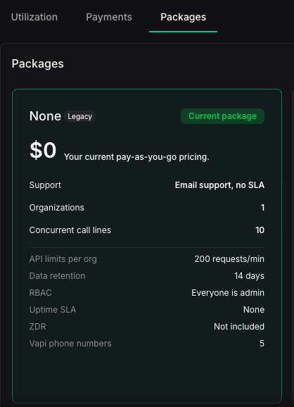
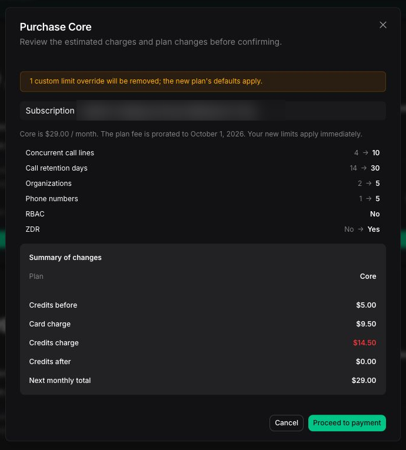

<Note>
This page applies if your Dashboard sidebar shows **Billing & Payment**. If you see **Billing & Add-Ons** under **Settings** instead, see [Manage pay-as-you-go billing and credits](/billing/manage-pay-as-you-go-billing) or [Purchase call concurrency](/billing/purchase-call-concurrency).
</Note>

A Success Package applies to a subscription and every organization it contains. Usage-based billing remains active when you add, change, or remove a Success Package. You can also purchase add-ons that increase specific capabilities without changing your Success Package.

Available add-ons can be used with Usage only or any Success Package.

See [Pricing and Success Packages](/billing/pricing-and-success-packages) to compare package support and service commitments before you change your package.

## Prerequisites

- An **Admin** role in the organization.
- A saved payment method for purchases made through the Dashboard. Add-ons also require one, even though they are paid from credits. See [Manage billing and credits](/billing/manage-billing-and-credits).
- Enough credits to cover an add-on purchase.

## See your current package

Check which Success Package you have, or confirm you are on Usage only, in the Dashboard.

<Steps>
  <Step title="Open Billing & Payment">
    In the [Vapi Dashboard](https://dashboard.vapi.ai), open **Billing & Payment**.
  </Step>
  <Step title="Open Packages">
    Select the **Packages** tab. Your current package is marked **Current package**, with its included limits, support, and compliance options listed.

    <Frame>
      
    </Frame>
  </Step>
</Steps>

## Change your Success Package

An upgrade increases the limits and support associated with your Success Package. A downgrade reduces them. Before you confirm a change, the Dashboard shows when it takes effect and any amount due.

### Upgrade to Core or Pro

Buy Core or Pro directly from the Dashboard when you need more support, capacity, or service commitments.

<Steps>
  <Step title="Open Packages">
    In the [Vapi Dashboard](https://dashboard.vapi.ai), open **Billing & Payment**, then select the **Packages** tab.
  </Step>
  <Step title="Select a package">
    Select **Purchase** on the package you want.
  </Step>
  <Step title="Review and pay">
    Review the changes, effective date, and amount due, then proceed to payment and confirm.

    <Frame caption="Subscription details blurred for privacy.">
      
    </Frame>
  </Step>
</Steps>

Your new package limits apply after you complete the purchase.

### Move to Premier

Premier has custom pricing and terms, set with our sales team.

<Steps>
  <Step title="Contact sales">
    On the **Premier** package, select **Contact sales**.
  </Step>
  <Step title="Submit your details">
    Complete the form with your company, work email, expected call volume, and use case, then submit. An account team member follows up to set custom terms in an agreement.
  </Step>
</Steps>

## Downgrade or remove a Success Package

Move to a lower Success Package when you need less support or capacity. You can also remove your Success Package and continue with Usage only. The Dashboard shows when the change takes effect before you confirm it.

<Warning>
You might need to reduce capacity before moving to a package with lower limits. For example, you cannot move to a package that supports fewer organizations than your subscription currently contains. See [Manage organizations and capacity](/billing/manage-organizations-and-capacity).
</Warning>

<Steps>
  <Step title="Start the downgrade">
    In the **Packages** tab, select a lower Success Package, or remove your current package to continue with **Usage only**.
  </Step>
  <Step title="Review the reductions">
    Review what the change reduces, such as concurrent call lines, organizations, data retention, support, and service-level agreements.
  </Step>
  <Step title="Confirm the change">
    Review the effective date shown in the Dashboard, then confirm the change.
  </Step>
</Steps>

## Buy capacity add-ons

Capacity add-ons increase a specific entitlement without changing usage-based billing or your Success Package:

- **Concurrent call lines** shared by all organizations in the subscription. Each line adds one simultaneous call on top of your subscription's included concurrency. All inbound and outbound calls share this capacity. A campaign's **Max concurrency** setting limits that campaign, but it does not reserve additional call lines.
- **Additional organizations** in the subscription, beyond the number your package includes. This add-on is not available on legacy pricing.

Review the recurring charge and effective date before confirming an add-on purchase. You cannot reduce an add-on below the capacity currently in use. See [call concurrency](/calls/call-concurrency) for how shared capacity works.

<Steps>
  <Step title="Open capacity add-ons">
    In **Billing & Payment**, select the **Packages** tab. Under **Add-ons**, find the **Capacity** section.
  </Step>
  <Step title="Set the amounts">
    On **Concurrent call lines**, select **Manage lines** and set the number of additional lines. To add organizations, use the **Organizations** row.
  </Step>
  <Step title="Review and confirm">
    Review the summary of changes and the estimated amount due today, then select **Confirm purchase**.
  </Step>
</Steps>

## Buy compliance and data add-ons

Compliance and data add-ons change how Vapi handles data for an organization. HIPAA and 60-day data retention are available with any package. Zero data retention (ZDR) is included in Core and Pro, and is not available as an add-on on Usage only.

<Steps>
  <Step title="Open compliance and data add-ons">
    In **Billing & Payment**, select the **Packages** tab. Under **Add-ons**, find the **Compliance & data** section.
  </Step>
  <Step title="Choose the add-on">
    To extend call and chat data retention, select **Set to 60 days**. To enable HIPAA, select **Enable HIPAA** and enter the signatory name and legal entity name. Vapi emails a Business Associate Agreement (BAA) to your billing email address.
  </Step>
  <Step title="Review and confirm">
    Review the summary of changes, then select **Confirm purchase**.
  </Step>
</Steps>

HIPAA compliance requires a signed BAA and compatible providers. See [HIPAA compliance](/security-and-privacy/hipaa) for requirements and data-handling behavior.

## Billing arrangements

The Dashboard shows the payment method, amount due, and renewal details before you confirm a purchase. Add-ons are charged to your Vapi credits on the first day of each month. See [How credits work](/billing/manage-billing-and-credits#how-credits-work). For invoiced subscriptions, including Premier, contact your account team. Purchase methods depend on your billing arrangement.

## Related

<CardGroup cols={2}>
  <Card title="Manage billing and credits" icon="fa-light fa-credit-card" href="/billing/manage-billing-and-credits">
    Manage payment methods, credit purchases, auto-reload, statements, and invoices.
  </Card>
  <Card title="Manage organizations and capacity" icon="fa-light fa-building" href="/billing/manage-organizations-and-capacity">
    Create organizations and resolve capacity before a downgrade.
  </Card>
</CardGroup>
