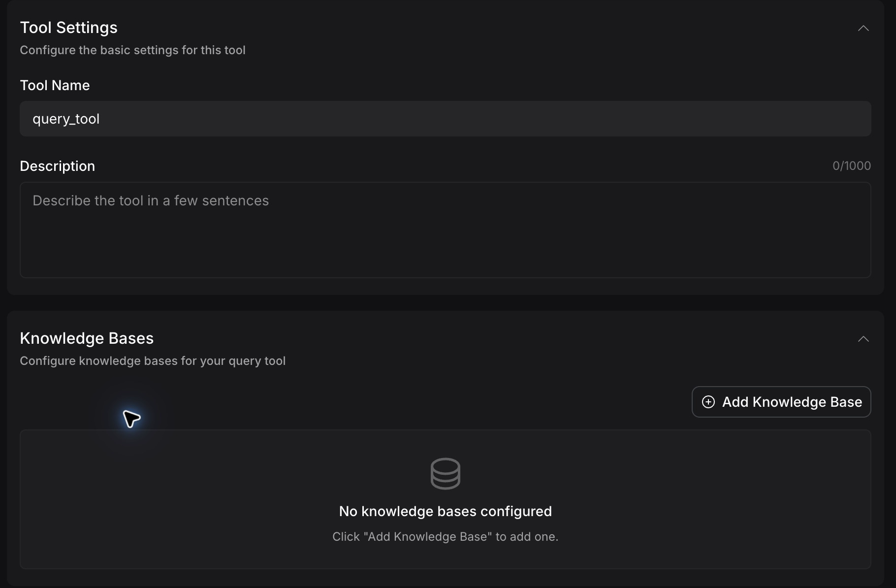

## **What is the Query Tool?**

The Query Tool is a powerful feature that allows your AI assistant to access and retrieve information from custom knowledge bases. By configuring a query tool with specific file IDs, you can enable your assistant to provide accurate and contextually relevant responses based on your custom data.

### **Benefits of Using the Query Tool**

- **Enhanced contextual understanding**: Your assistant can access specific knowledge to answer domain-specific questions.
- **Improved response accuracy**: Responses are based on your verified information rather than general knowledge.
- **Customizable knowledge retrieval**: Configure multiple knowledge bases for different topics or domains.

## **How to Configure a Query Tool for Knowledge Bases**

### **Step 1: Upload Your Files**

Before creating a query tool, you need to upload the files that will form your knowledge base.

#### Option 1: Using the Dashboard (Recommended)

1. Open [the Vapi Dashboard](https://dashboard.vapi.ai), select **Resources**, then select **Files**.
2. Select **Upload file** and choose a file from your computer. Repeat for each file.
3. Wait for each file to appear in the **Files** list.
4. Select each file and copy its `id` from the details panel if you need the ID for the API method.

#### Option 2: Using the API

Alternatively, you can upload files via the API:

```bash
curl --location 'https://api.vapi.ai/file' \
--header 'Authorization: Bearer <YOUR_API_KEY>' \
--form 'file=@"<PATH_TO_YOUR_FILE>"'
```

The API response contains file IDs for the next step.

### **Step 2: Create a Query Tool**

Create a query tool that references your knowledge base files:

#### Option 1: Using the Dashboard (Recommended)

1. Select **Tools** in the Dashboard, then select **Create Tool** and **Query**.
2. Set **Tool Name** to a descriptive name, such as `product-query`.
3. Under **Knowledge Bases**, select **Add Knowledge Base**.
4. Set **Name** to `product-kb` and enter a **Description** of the content.
5. Choose a **Model** and, under **Files**, select the files you uploaded in Step 1.
6. Select **Publish** to apply the saved draft.

<Frame caption="Query tool settings in the Dashboard">
  
</Frame>

#### Option 2: Using the API

Alternatively, you can create the tool via API:

```bash
curl --location 'https://api.vapi.ai/tool/' \
--header 'Content-Type: application/json' \
--header 'Authorization: Bearer <YOUR_API_KEY>' \
--data '{
    "type": "query",
    "function": {
        "name": "product-query"
    },
    "knowledgeBases": [
        {
            "provider": "google",
            "name": "product-kb",
            "description": "Contains comprehensive product information, service details, and company offerings",
            "fileIds": [
                "41a2bd44-d13c-4914-bbf7-b19807dd2cf4",
                "ef82ae15-21b2-47bd-bde4-dea3922c1e49"
            ]
        }
    ]
}'
```

<Note>
  The `description` field in the knowledge base configuration helps your
  assistant understand when to use this particular knowledge base. Make it
  descriptive of the content.
</Note>

### **Step 3: Attach the Query Tool to Your Assistant**

After creating the query tool, you need to attach it to your assistant:

#### Option 1: Using the Dashboard (Recommended)

1. Select **Assistants** in the Dashboard and open the assistant you want to configure.
2. Open the **Tools** tab, select **Add tool**, then choose your query tool.
3. Open the **Assistant** tab and update the system prompt to say when to use the tool (see examples below).
4. Select **Publish**, review the changes and version settings, then publish the draft.

#### Option 2: Using the API

Alternatively, you can attach the tool via API using the tool ID:

```bash
curl --location --request PATCH 'https://api.vapi.ai/assistant/ASSISTANT_ID' \
--header 'Authorization: Bearer <YOUR_API_KEY>' \
--data '{
    "model": {
        "temperature": 0.2,
        "provider": "openai",
        "model": "gpt-4o",
        "toolIds": [
            "9441840b-6f2f-4b0f-a0fc-de8512549a0c"
        ]
    }
}'
```

<Warning>
  When using the PATCH request, you must include the entire model object, not
  just the toolIds field. This will overwrite any existing model configuration.
</Warning>

<Note>
  **Don't forget**: After attaching the tool via API, you must also update your assistant's system prompt (in the `messages` array) to instruct when to use the tool by name. See the system prompt examples below.
</Note>

## **Advanced Configuration Options**

### **Multiple Knowledge Bases**

You can configure multiple knowledge bases within a single query tool:

```json
"knowledgeBases": [
    {
        "provider": "google",
        "name": "product-documentation",
        "description": "Contains detailed product specifications, feature descriptions, and technical details",
        "fileIds": ["file-id-1", "file-id-2"]
    },
    {
        "provider": "google",
        "name": "troubleshooting-guide",
        "description": "Contains troubleshooting guides, support procedures, and problem resolution steps",
        "fileIds": ["file-id-3", "file-id-4"]
    }
]
```

### **Knowledge Base Description**

The description field should explain what content the knowledge base contains:

```json
"description": "Contains pricing information, subscription plans, and billing documentation"
```

### **Assistant System Prompt Integration**

<Warning>
  **Important**: You must explicitly instruct your assistant in its system prompt about when to use the query tool. The knowledge base description alone is not sufficient for the assistant to know when to search.
</Warning>

Add clear instructions to your assistant's system messages, **explicitly naming the tool**:

```json
{
  "role": "system",
  "content": "You are a helpful customer support assistant. When users ask about products, pricing, features, or need troubleshooting help, use the 'knowledge-search' tool to search our knowledge base for accurate information. Always call the knowledge-search tool before providing answers to ensure accuracy."
}
```

<Note>
  **Be specific**: Replace `'knowledge-search'` with your actual tool's function name from the query tool configuration.
</Note>

**Example system prompt instructions with specific tool names:**
- **Product Support**: "When users ask about product features, specifications, or troubleshooting, use the 'product-support-search' tool to find relevant information."
- **Billing Questions**: "For any questions about pricing, billing, or subscription plans, use the 'billing-query' tool to find the most current information."
- **Technical Documentation**: "When users need API documentation, code examples, or integration help, use the 'api-docs-search' tool to search the technical knowledge base."

## **Best Practices for Query Tool Configuration**

- **Organize by topic**: Create separate knowledge bases for distinct topics to improve retrieval accuracy.
- **Use descriptive names**: Name your knowledge bases clearly to help your assistant understand their purpose.
- **Include system prompt instructions**: Always add explicit instructions to your assistant's system prompt about when to use the query tool.
- **Update regularly**: Refresh your knowledge bases as information changes to ensure accuracy.
- **Test thoroughly**: After configuration, test your assistant with various queries to ensure it retrieves information correctly.

<Tip>
  For optimal performance, keep individual files under 300KB and ensure they
  contain clear, well-structured information.
</Tip>

By following these steps and best practices, you can effectively configure the query tool to enhance your AI assistant with custom knowledge bases, making it more informative and responsive to user queries.
