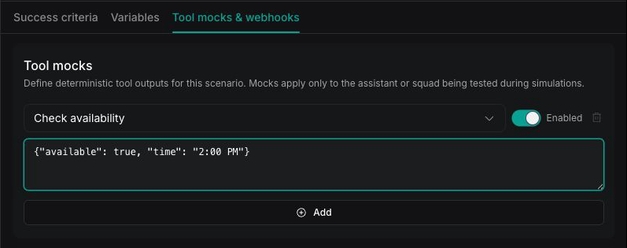
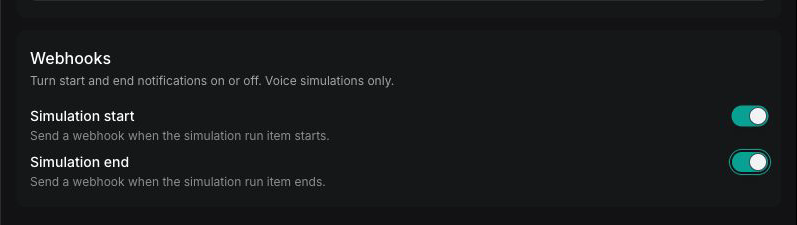

Advanced simulation options let you set variable values, mock tool responses, trigger lifecycle webhooks, set latency limits, and reuse structured outputs. Use them after you complete the [**Simulations quickstart**](/observability/simulations-quickstart) and need more control over behavior or test conditions.

## How it works

Advanced options belong to each simulation in a suite. They control which values the [**assistant**](/assistants) or [**squad**](/squads) receives, what mocked tools return, and which lifecycle events send webhooks.

Open a suite and select **Edit**, then **Next**. The review step contains the **Success criteria**, **Variables**, and **Tool mocks & webhooks** tabs.

<CardGroup cols={2}>
  <Card title="Configure the AI tester" icon="robot" href="/observability/simulations-configure-ai-tester">
    Define the AI tester's scenario, behavior, model, transcriber, and voice.
  </Card>
  <Card title="Set variables" icon="brackets-curly" href="#set-variable-values-for-the-assistant-or-squad">
    Supply dynamic-variable values without editing the assistant or squad.
  </Card>
  <Card title="Mock tool responses" icon="wrench" href="#mock-tool-responses">
    Return fixed tool results without calling live services.
  </Card>
  <Card title="Send lifecycle webhooks" icon="webhook" href="#send-webhooks-on-run-start-and-end">
    Notify your server when a simulation starts or ends.
  </Card>
  <Card title="Reuse structured outputs" icon="database" href="#reuse-structured-outputs">
    Apply the same evaluation criterion across simulations.
  </Card>
  <Card title="Set latency limits" icon="stopwatch" href="#set-latency-limits">
    Fail a voice simulation when the assistant responds too slowly.
  </Card>
  <Card title="Manage test coverage" icon="flask" href="/observability/simulations-manage#testing-strategies">
    Build coverage with smoke tests, regression tests, and edge cases.
  </Card>
</CardGroup>

## Mock tool responses

During a simulation, the [**assistant**](/assistants) or [**squad**](/squads) under test runs its real [**tools**](/tools). Mock a tool to return fixed text instead, so that tool never calls its live service or API. A mock intercepts only the tool it names; every other tool the assistant or squad calls still runs for real.

<Note>
Suites that [Composer generates](/composer#generate-tests-for-an-assistant) come with mocks already set. Every tool in the assistant's tool list that would reach an external system is mocked, including handoffs and transfers that can't run safely. Tools that only end or route the conversation run normally, such as end call, voicemail, DTMF, and static handoffs.

To change a generated mock, edit the suite and open **Tool mocks & webhooks**. Change the **Mock result**, or turn off **Enabled** to run the tool live. Suites you build yourself start with no mocks, so every tool runs for real until you add one.
</Note>

<Warning>

Generated mocks don't cover everything. Tools that only an assistant [**hook**](/assistants/assistant-hooks) calls aren't mocked. Explicit [scenario webhooks](#send-webhooks-on-run-start-and-end), unmocked tools, and destination requests can still contact your server. Simulation lifecycle [server messages](/server-url), including the end-of-call report, are suppressed, and simulation runs don't trigger your [monitors](/observability/monitoring-quickstart); that doesn't disable these other requests. Check them before running against production systems.
</Warning>

<Tabs>
<Tab title="Dashboard">

On the review step, open **Tool mocks & webhooks**. Under **Tool mocks**, select **Add**, then configure each mock with three fields:

- **Tool**: Select one of the [**tools**](/tools) configured on the assistant or squad. Only its configured tools, including [**Function tools**](/tools/custom-tools), can be mocked.
- **Mock result**: Enter the string returned in place of the tool's live output.
- **Enabled**: Toggle the mock on or off. A disabled mock is ignored, and the tool runs live.

<Frame>
  
</Frame>

</Tab>
<Tab title="cURL">

Tool mocks are a property of the scenario. Add them when you create a scenario, or patch an existing one:

```bash
curl -X PATCH "https://api.vapi.ai/eval/simulation/scenario/<scenario-id>" \
  -H "Authorization: Bearer $VAPI_API_KEY" \
  -H "Content-Type: application/json" \
  -d '{
    "toolMocks": [
      {
        "toolName": "bookAppointment",
        "result": "{\"status\": \"success\", \"confirmationId\": \"MOCK-12345\"}",
        "enabled": true
      }
    ]
  }'
```

`toolName` must match the tool's name exactly, and only tools configured on the assistant or squad can be mocked. Set `enabled` to `false` to keep a mock defined without applying it.

</Tab>
</Tabs>

The mock result is always passed to the assistant or squad as a string. In the Dashboard, enter plain text or JSON-formatted text directly. In a cURL JSON body, escape the quotation marks inside JSON-formatted text, as shown in the example. Use tool mocks to keep tool behavior deterministic, avoid side effects, and steer the conversation down a specific path without depending on a live service.

### Common mock patterns

Choose a result that leads the assistant or squad through the behavior you want to test. These examples show how the `result` field appears in a cURL JSON body:

<Tabs>
<Tab title="Success">

Return the data that the tool normally provides after a successful action:

```json
{
  "result": "{\"status\": \"success\", \"confirmationId\": \"APT-12345\"}"
}
```

</Tab>
<Tab title="Handled error">

Return an error and recovery options to test how the assistant responds:

```json
{
  "result": "{\"error\": \"Time slot no longer available\", \"availableSlots\": [\"14:30\", \"15:00\"]}"
}
```

</Tab>
<Tab title="Unavailable service">

Return plain text to test how the assistant handles a service that is unavailable:

```json
{
  "result": "The booking service is temporarily unavailable."
}
```

</Tab>
</Tabs>

These strings replace the selected tool's output. They do not produce an HTTP error, add network latency, or cause a network timeout.

## Handoffs and transfers in simulations

In a simulation, a [**handoff**](/squads/handoff) with a fixed list of destinations runs only when the model picks one of them. If the model names no destination, asks for `dynamic`, or names an assistant that isn't on the list, the handoff is refused. The assistant doesn't switch, and the model is asked to try again with a listed destination. Your server isn't asked for a destination. On a live call, a missing or `dynamic` destination can instead trigger a request to your server.

A [**dynamic handoff**](/squads/handoff/destinations#dynamic-handoffs) runs as it does on a live call, so it asks your server for a destination unless you [mock it](#mock-tool-responses).

In a suite you build yourself, `transferCall` isn't mocked automatically. In a voice simulation, an external transfer ends the simulation without dialing the phone number or SIP destination, so it doesn't test that destination. If the tool asks your server to choose a destination, that lookup can still run. Mock the tool to avoid that request, and use a real test call to test the external transfer itself.

### Gaps in generated suites

When [Composer generates a suite](/composer#generate-tests-for-an-assistant), it lists each handoff or transfer the suite doesn't exercise as **Not tested**, with the reason:

| Reason | What the suite does |
| --- | --- |
| Your server chooses the destination (a dynamic handoff) | Mocks the handoff. |
| It transfers to a phone number or your server | Mocks the transfer. |
| The destination assistant couldn't be checked. It uses MCP tools or a pinned version, it didn't load, or Composer reached its limit on how many assistants it reads. | Mocks the handoff into it. |
| It hands off by assistant name outside a [**squad**](/squads) | Doesn't mock it. A name-based handoff can't resolve outside a squad, so the simulation never reaches it. |
| A built-in tool, such as `endCall`, has the same name as a mocked tool | The mock answers both. |

Other supported handoffs and assistant-to-assistant transfers run normally. Cover the paths above with test calls against sandbox systems.

## Hooks and call endings

Simulations run the [**hooks**](/assistants/assistant-hooks) on the assistant or squad under test, just like a real call. For example, a `call.ending` hook runs in a voice simulation. The exception is `customer.speech.timeout`. Those hooks are removed from the assistant and every squad member so the assistant doesn't prompt the AI tester when the tester pauses. To test re-engagement, set `targetOverrides.hooks` on the scenario. Those hooks are used exactly as set.

If the AI tester hangs up first in a voice simulation, the call ends with `customer-ended-call`, just like a real caller hanging up. Anything that depends on a caller hang-up runs normally.

## Send webhooks on run start and end

Turn on webhooks to notify your server when a simulation iteration starts or ends. Each webhook sends a `POST` request to the URL you configure.

<Tabs>
<Tab title="Dashboard">

On the **Tool mocks & webhooks** tab, under **Webhooks**, toggle **Simulation start** and **Simulation end**.

<Frame>
  
</Frame>

</Tab>
<Tab title="cURL">

Webhooks are configured as `hooks` on the scenario:

```bash
curl -X PATCH "https://api.vapi.ai/eval/simulation/scenario/<scenario-id>" \
  -H "Authorization: Bearer $VAPI_API_KEY" \
  -H "Content-Type: application/json" \
  -d '{
    "hooks": [
      {
        "on": "simulation.run.started",
        "do": [{ "type": "webhook", "server": { "url": "URL_START" } }]
      },
      {
        "on": "simulation.run.ended",
        "do": [{
          "type": "webhook",
          "server": { "url": "URL_END" },
          "include": { "transcript": true, "messages": true, "recordingUrl": true }
        }]
      }
    ]
  }'
```

</Tab>
</Tabs>

Vapi sends `simulation.run.started` when a simulation iteration begins. The example below is a voice payload. A chat payload omits the `calls` object:

```json
{
  "type": "simulation.run.started",
  "simulationId": "8f2a9c1e-3b4d-4a7e-9c2f-1d6b0a5e7f34",
  "runId": "b7d4e2a0-6c9f-4e13-8a52-2f7c9b1d4e60",
  "simulationRunItemId": "c3e8f1a2-9d47-4b6c-8e30-5a1f2b9c7d84",
  "iterationNumber": 1,
  "isSimulation": true,
  "calls": {
    "testerCallId": "a1b2c3d4-...",
    "targetCallId": "e5f6a7b8-...",
    "listenUrl": "wss://..."
  }
}
```

Vapi sends `simulation.run.ended` when the simulation iteration finishes. The example below is a voice payload. A chat payload omits `calls`, `endedReason`, and `recordingUrl`:

```json
{
  "type": "simulation.run.ended",
  "simulationId": "8f2a9c1e-3b4d-4a7e-9c2f-1d6b0a5e7f34",
  "runId": "b7d4e2a0-6c9f-4e13-8a52-2f7c9b1d4e60",
  "simulationRunItemId": "c3e8f1a2-9d47-4b6c-8e30-5a1f2b9c7d84",
  "iterationNumber": 1,
  "isSimulation": true,
  "calls": { "testerCallId": "a1b2c3d4-...", "targetCallId": "e5f6a7b8-...", "listenUrl": "wss://..." },
  "endedReason": "...",
  "canceled": false,
  "failureReason": "...",
  "startedAt": "2026-07-28T17:10:05.000Z",
  "endedAt": "2026-07-28T17:12:30.000Z",
  "transcript": "...",
  "messages": [],
  "recordingUrl": "https://..."
}
```

Both chat and voice payloads include `simulationId`, `runId`, `simulationRunItemId`, `iterationNumber`, and `isSimulation`. The ended event adds `startedAt` and `endedAt`, plus `transcript` and `messages` when you include them. The call-specific fields appear for **voice simulations only**: `calls`, `endedReason`, and `recordingUrl`. The `calls` object includes `calls.listenUrl`, a WebSocket URL for monitoring the run in real time. For the complete list of `endedReason` values, see [**Call ended reasons**](/calls/call-ended-reason).

## Reuse structured outputs

Each evaluation references a [**structured output**](/assistants/structured-outputs-quickstart). Reuse a structured output when several simulations should apply the same evaluation criterion. For more patterns, see [**structured output examples**](/assistants/structured-outputs-examples).

<Tabs>
<Tab title="Dashboard">

Reuse an existing structured output across simulations to keep the same criterion consistent, or create a new one inline from the **Success criteria** tab.

</Tab>
<Tab title="cURL">

Reference an existing structured output by `structuredOutputId` in an evaluation instead of defining one inline:

```bash
curl -X PATCH "https://api.vapi.ai/eval/simulation/scenario/<scenario-id>" \
  -H "Authorization: Bearer $VAPI_API_KEY" \
  -H "Content-Type: application/json" \
  -d '{
    "evaluations": [
      { "structuredOutputId": "<structured-output-id>", "comparator": "=", "value": true, "required": true }
    ]
  }'
```

</Tab>
</Tabs>

## Set latency limits

A latency limit fails a voice simulation when the [**assistant**](/assistants) or [**squad**](/squads) under test responds too slowly. Vapi measures latency on each turn of the call, combines the turns into one number, and passes the limit when that number is at or below the limit you set.

Latency limits work alongside structured-output evaluations. A scenario still needs at least one evaluation, and a required limit that fails marks the simulation as failed even when every evaluation passes.

<Tabs>
<Tab title="Dashboard">

On the **Success criteria** tab, under **Latency expectations**, select **Add latency expectation**. Configure each limit with four fields:

- **Aggregation**: How the call's turns are combined: **Median**, **Mean**, **P95**, or **Max**.
- **Metric**: **Turn latency**, **Model latency**, or **Voice latency**.
- **Limit**: The maximum in milliseconds, as a whole number from 1 to 60,000.
- **Required**: Turn off to make the limit informational. An optional limit is reported but never fails the simulation.

A new limit starts as a required median turn latency of 1,200 ms. Each simulation can have up to 20 limits.

</Tab>
<Tab title="cURL">

Latency limits are the `latencyExpectations` property of the scenario. Add them when you create a scenario, or patch an existing one:

```bash
curl -X PATCH "https://api.vapi.ai/eval/simulation/scenario/<scenario-id>" \
  -H "Authorization: Bearer $VAPI_API_KEY" \
  -H "Content-Type: application/json" \
  -d '{
    "latencyExpectations": [
      { "metric": "turn", "aggregation": "median", "thresholdMs": 1200 },
      { "metric": "model", "aggregation": "p95", "thresholdMs": 800, "required": false }
    ]
  }'
```

`required` defaults to `true`. Sending `latencyExpectations` replaces the scenario's existing limits, and an empty array removes them.

</Tab>
</Tabs>

### Metrics and aggregations

Each metric reads one field of the per-turn latency that every call records, measured the same way as on a live call. See [per-turn latency on a call](/assistants/model-intelligence/understanding-latency#per-turn-latency-on-a-call) for exactly where each one starts and ends.

| Metric | Field | What it measures |
| --- | --- | --- |
| `turn` | `turnLatency` | Time from the end of the AI tester's speech to the assistant starting its reply |
| `model` | `modelLatency` | Time from the start of the turn's model stage, including knowledge base retrieval, to the model's first output token |
| `voice` | `voiceLatency` | Time from the model's first output token to the first reply audio being ready, including the voice provider and any sample-rate conversion |

`model` and `voice` happen inside `turn`, so they don't add up to it. Turns that recorded `0` for `model` or `voice` didn't measure it and are left out of those metrics. The AI tester speaks with clean synthetic audio, so transcription, endpointing, and turn latency can run faster than with real callers.

The aggregation reduces the call's turns to one value: `mean`, `median`, `p95`, or `max`. `p95` uses the nearest-rank method, so on a call with fewer than 20 turns it equals `max`. Measured values are rounded to the nearest millisecond before they are compared with the limit.

<Tip>
  Gate on median turn latency. A short simulation has only a few turns, so `p95` and `max` can fail on a single slow turn. To watch the slowest turns without failing runs, add an optional `p95` or `max` limit next to a required `median` limit on the same metric.
</Tip>

### When a limit is skipped

| Situation | Result |
| --- | --- |
| The run uses chat mode | Skipped. Chat runs have no audio, so there is no latency to measure. |
| The assistant under test uses [**GPT-Live**](/gpt-live/overview) | Skipped. Per-turn latency isn't measured for GPT-Live assistants yet. A GPT-Live AI tester talking to a classic assistant is still measured. |
| A voice run where no turn measured the metric | The limit fails. A latency that couldn't be measured never counts as within the limit. |

Skipped limits don't affect the result.

### Review latency results

Open a run and select a simulation. The **Latency** section shows average turn latency when at least one turn was measured. Each limit shows its threshold and result. When at least one turn measured that limit's metric, the result also shows the measured value and number of turns. Optional and skipped limits are labeled. When a simulation fails, the count in the results list, such as `1 of 3 evaluations failed`, includes its latency limits.

Through the API, each run item's `results.latencyEvaluations` holds one entry per limit with `actualMs`, `thresholdMs`, `sampleCount`, `passed`, `required`, and, for skipped limits, `isSkipped` and `skipReason`. `results.passed` accounts for required latency limits.

## Set variable values for the assistant or squad

Variables provide values for the [**dynamic variables**](/assistants/dynamic-variables) used by the [**assistant**](/assistants) or [**squad**](/squads) during the simulation. On the **Variables** tab, add **Name** and **Value** pairs. Each name must match a `{{variable}}` placeholder in the assistant's prompt, and the value is substituted during the run.

Use variables to test specific inputs, such as a customer name or account tier, without editing the assistant or squad.

### Simulate a call from a specific phone number

Assistants that identify callers by phone number, for example by passing `{{customer.number}}` to an account lookup tool, need a known caller number to test against. Set `customer.number` in the scenario's `targetOverrides.variableValues`. The **Variables** tab only accepts flat names, so set this value through the API:

```bash
curl -X PATCH "https://api.vapi.ai/eval/simulation/scenario/<scenario-id>" \
  -H "Authorization: Bearer $VAPI_API_KEY" \
  -H "Content-Type: application/json" \
  -d '{
    "targetOverrides": {
      "variableValues": {
        "customer": { "number": "+14155550123" }
      }
    }
  }'
```

For a transient scenario, set the same `targetOverrides` on the inline `scenario` in `POST /eval/simulation/run`.

- The value replaces the whole `customer` variable, so also set any other `customer` fields the assistant references, such as `customer.name`.
- Only `{{customer.number}}` changes. The `call.customer` object in server messages does not, so a tool that reads the caller from the message payload won't see the override.
- To test the conversation without a real lookup, [mock the tool](#mock-tool-responses) instead.

## Troubleshooting

| Issue | What to check |
| --- | --- |
| Every iteration fails | Review the transcript, then verify the evaluation's description, data type, comparator, and expected value. |
| A run stays queued or running | Check the assistant or squad configuration and its provider credentials. Fetch the run and its items to find a failure reason. |
| Creating a voice run returns `400 Target assistant would fail to start a call: <message>` | The inline assistant in `target` has a configuration a call would reject, such as a tool type the model doesn't support. Fix what the message names, then create the run again. This check runs only for voice runs with an inline assistant target, not for a saved `assistantId`, a squad, or a chat run. |
| A run item fails with `Failed to create target call: <message>` | The assistant or squad under test failed call validation when the run item started its call. Fix what the message names, then rerun. No AI tester call is started for that item. |
| Results vary between runs | Make the intent and evaluations more specific, then run multiple iterations to measure consistency. |
| There is no audio or recording | Check whether the run used chat mode. Use voice mode to test or record audio. |
| Start or end webhooks do not trigger | Confirm the corresponding hook and its URL are configured on the scenario. |
| A tool mock does not apply | Confirm that `toolName` matches the configured tool name exactly and that `enabled` is `true`. |
| A handoff is refused in the transcript | The model gave no destination, `dynamic`, or an assistant the handoff doesn't list. Check the handoff's destinations and the prompt's routing instructions. See [**Handoffs and transfers in simulations**](#handoffs-and-transfers-in-simulations). |
| A generated suite lists a handoff or transfer as **Not tested** | That path couldn't run safely, so Composer mocked it, or the simulation can't reach it. Cover it with a test call. See [**Gaps in generated suites**](#gaps-in-generated-suites). |
| The assistant never asks whether the AI tester is still there | Simulations remove `customer.speech.timeout` hooks. To test them, set `targetOverrides.hooks` on the scenario. See [**Hooks and call endings**](#hooks-and-call-endings). |
| A voice simulation's assistant call ends as `customer-ended-call` | The AI tester hung up first, which matches a real caller hanging up. |
| A tool looks up the wrong caller | Set `customer.number` in the scenario's variable values. See [**Simulate a call from a specific phone number**](#simulate-a-call-from-a-specific-phone-number). |
| A latency limit fails without a measured value | No turn in the call measured that metric. Confirm the run used voice mode and that the conversation completed at least one exchange. |
| Latency limits show as skipped | Check whether the run used chat mode or the assistant under test uses GPT-Live. Both skip latency limits. |

## Next steps

<CardGroup cols={2}>
  <Card title="Simulations overview" icon="circle-info" href="/observability/simulations-overview">
    Learn what Simulations are and when to use them instead of Evals.
  </Card>
  <Card title="Simulations quickstart" icon="rocket" href="/observability/simulations-quickstart">
    Create and run your first simulation suite.
  </Card>
  <Card title="Manage simulations" icon="gear" href="/observability/simulations-manage">
    Edit suites, review and rerun results, maintain test coverage, and delete suites.
  </Card>
  <Card title="Structured outputs quickstart" icon="database" href="/assistants/structured-outputs-quickstart">
    Define the structured outputs used in evaluations.
  </Card>
</CardGroup>
