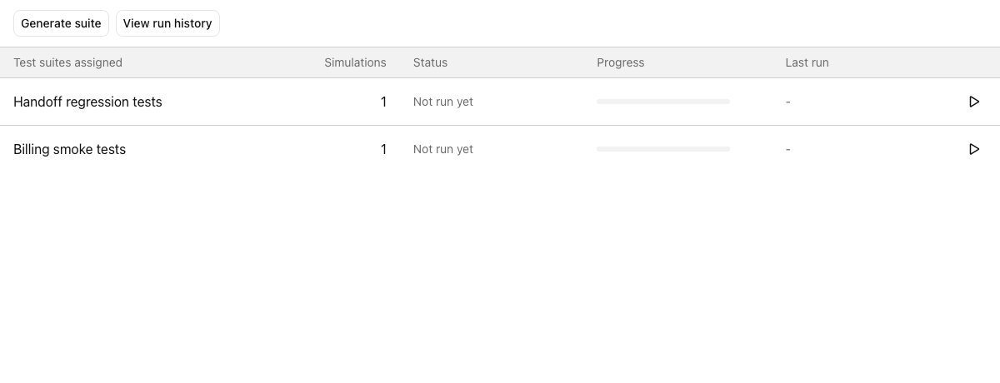

The **Test** tab lists [**simulation suites**](/observability/simulations-overview) that include this assistant in their target assignments. This includes suites Composer generates for the assistant and suites you assign to it yourself. From the tab, you can generate a suite with Composer, run or rerun a suite, and open its results and run history without leaving the assistant.

## Prerequisites

- An [**assistant**](/assistants) in your Vapi account.
- Permission to read test suites and test runs. Without both, you won't see the **Test** tab.
- To generate a suite, permission to create test suites.
- To run a suite, permission to create test runs.

<Note>
  Runs use the published version of the assistant. If you're editing a draft, the tab shows **Runs use the published version**. Publish your changes to test them. If [**traffic splitting**](/assistants/versioning/traffic-splitting) is enabled, publish the new version with 0% traffic so it handles no live calls.
</Note>

## Generate a suite with Composer

Open the assistant and select the **Test** tab. If no suites are assigned to the assistant, the tab shows **No test suites yet** with **Generate with Composer** and an **About simulations** link. Once the assistant has suites, select **Generate suite** above the table to create another.

<Frame caption="The Test tab before an assistant has any assigned suites.">
  
</Frame>

Both buttons open [**Composer**](/composer#generate-tests-for-an-assistant) in a new thread for this assistant:

<Steps>
  <Step title="Review the test requirements">
    Composer reads the assistant's prompt and tools and drafts **Test requirements**. Select **Generate coverage** to accept them, or type the changes you want in the chat.
  </Step>

  <Step title="Review the generated suite">
    Composer generates simulations from the requirements and saves them as a suite assigned to the assistant. The suite card shows **Saved to the Test tab**. Tools that reach your systems are mocked by default, and each simulation lists any tools it mocks.
  </Step>

  <Step title="Run the suite">
    Select **Run suite** on the card to start a chat run with one iteration. The suite also appears in the **Test** tab.
  </Step>
</Steps>

## Read the suite table

The table shows up to 100 suites assigned to the assistant, one row per suite, with the latest run of that suite against this assistant.

<Frame caption="Each assigned suite has its own run status and actions.">
  
</Frame>

| Column | What it shows |
| -- | -- |
| **Test suites assigned** | The suite name. Once the suite has run, select the row to open its latest run. |
| **Simulations** | How many simulations the latest run executed, with its chat or voice mode. Before the first run, the number of simulations in the suite. |
| **Status** | The latest run's status: **Queued**, **Running**, **Passed**, **Failed**, **Errored**, or **Canceled**. A suite that has never run for this assistant shows **Not run yet**. |
| **Progress** | A bar of the latest run's outcomes. During a run, it shows how many simulations are complete, such as `2 of 5 complete`. After the run, it summarizes the outcomes, such as `4 passed · 1 failed or errored`. |
| **Last run** | When the latest run ended, such as `5 minutes ago`. It updates every minute while the tab is open. |

Each row ends with a **Run** or **Rerun** button. Once a suite has run, the row also shows a run history button that opens **Simulations** > **Runs** filtered to that suite and this assistant. To see every run for the assistant, select **View run history** above the table.

## Run a suite

Select **Run** on a suite that has never run for this assistant. If the suite can run in chat, it starts immediately as a chat run with one iteration, and the row updates as it progresses.

In these cases, the **Run suite** dialog opens instead, so you can choose the mode and iterations:

- The assistant needs voice, such as one that uses a GPT-Live model. **Voice** is the only mode offered.
- A simulation in the suite, its scenario, or its AI tester personality couldn't be loaded, for example because it was deleted.
- A scenario has hooks configured.

To run a suite again, select **Rerun**. The dialog always opens so you can choose **Chat** or **Voice** and the number of **Iterations**. The mode defaults to the previous run's. Each rerun creates a new run and picks up any changes made to the suite.

<Note>
  A suite with no simulations can't run. Add at least one simulation before running it. **Run** and **Rerun** stay disabled while a run of the suite is queued or running.
</Note>

## Next steps

<CardGroup cols={2}>
  <Card title="Simulations quickstart" icon="rocket" href="/observability/simulations-quickstart">
    Build and run a simulation suite step by step.
  </Card>
  <Card title="Manage simulations" icon="sliders" href="/observability/simulations-manage">
    Edit suites, review results, and maintain coverage.
  </Card>
  <Card title="Mock tool responses" icon="flask" href="/observability/simulations-advanced#mock-tool-responses">
    Control what tools return during a simulation.
  </Card>
  <Card title="Composer" icon="wand-magic-sparkles" href="/composer#generate-tests-for-an-assistant">
    Generate tests for an assistant in conversation.
  </Card>
</CardGroup>
