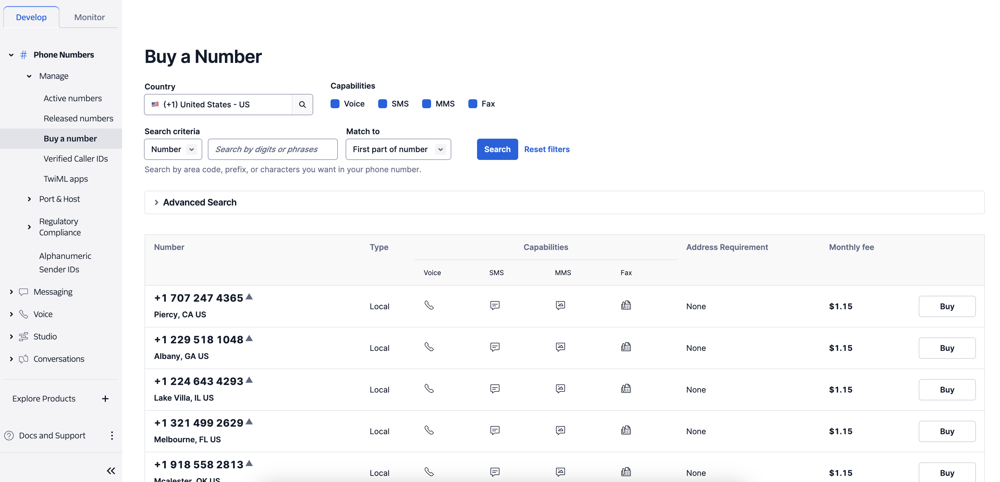
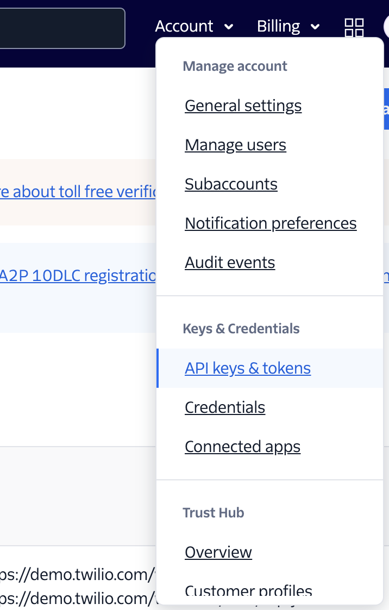
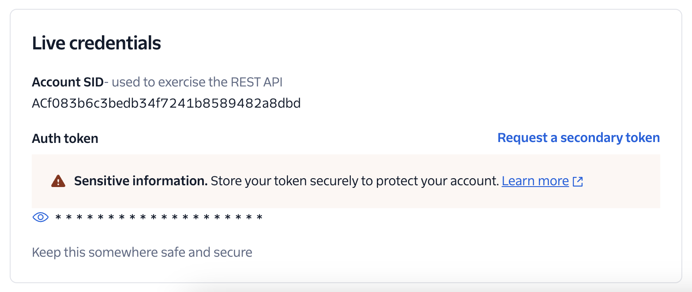
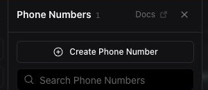
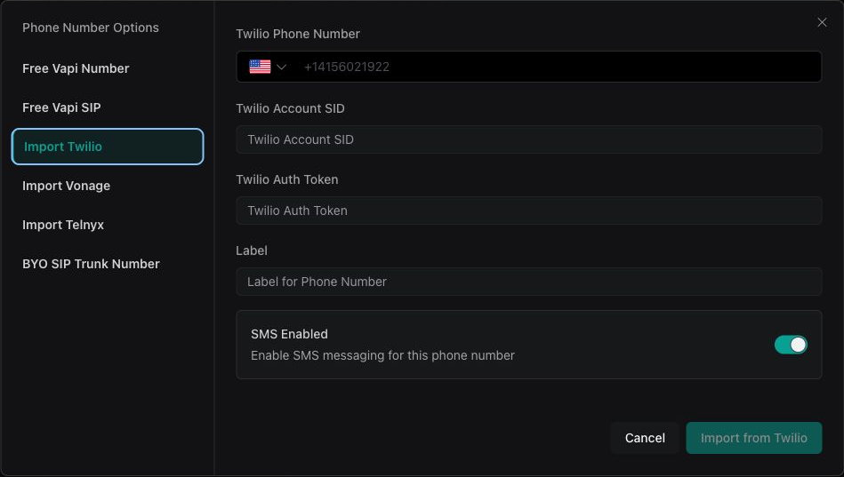

## Overview

As you scale your agents, you may want to use other telephony providers, like Twilio. In this guide, you'll learn how to add a new or existing Twilio number to Vapi.

## Prerequisites

- [A Twilio account](https://console.twilio.com/)
- A Twilio phone number
- Your Twilio Account SID and Auth Token

## Get started

<Steps>
  <Step title="Buy a Twilio phone number (if needed)">
    If you do not have a Twilio phone number, purchase one from the **Buy a number** section of the Twilio Console.
    <Frame caption="The Twilio 'Buy a Number' page in the Twilio console.">
      
    </Frame>
  </Step>
  <Step title="Get your Twilio credentials">
    Open the Twilio Console Dashboard and locate **Account Info**. Copy the **Account SID**, then reveal and copy the **Auth Token**. See Twilio's guide to [finding your Auth Token](https://help.twilio.com/articles/223136027).

    <Frame caption="Navigate to the credentials section of your Twilio account.">
      
    </Frame>
    <Frame>
      
    </Frame>
  </Step>
  <Step title="Open the phone number options">
    Open the [Dashboard](https://dashboard.vapi.ai), select **Phone Numbers**, and select **Create Phone Number**.

    <Frame caption="Create a phone number">
      
    </Frame>

    Choose **Import Twilio** under **Phone Number Options**.
  </Step>
  <Step title="Enter the Twilio number and credentials">
    Enter the number, including its country code, in **Twilio Phone Number**. Enter your **Twilio Account SID** and **Twilio Auth Token**.

    Optionally, enter a descriptive **Label** and choose whether **SMS Enabled** should be on. Then select **Import from Twilio**.

    <Frame caption="Import a Twilio phone number">
      
    </Frame>
  </Step>
  <Step title="Use the imported number">
    Open the imported phone number. You can now assign it to an assistant for inbound calls or use it to place outbound calls.
  </Step>
</Steps>
