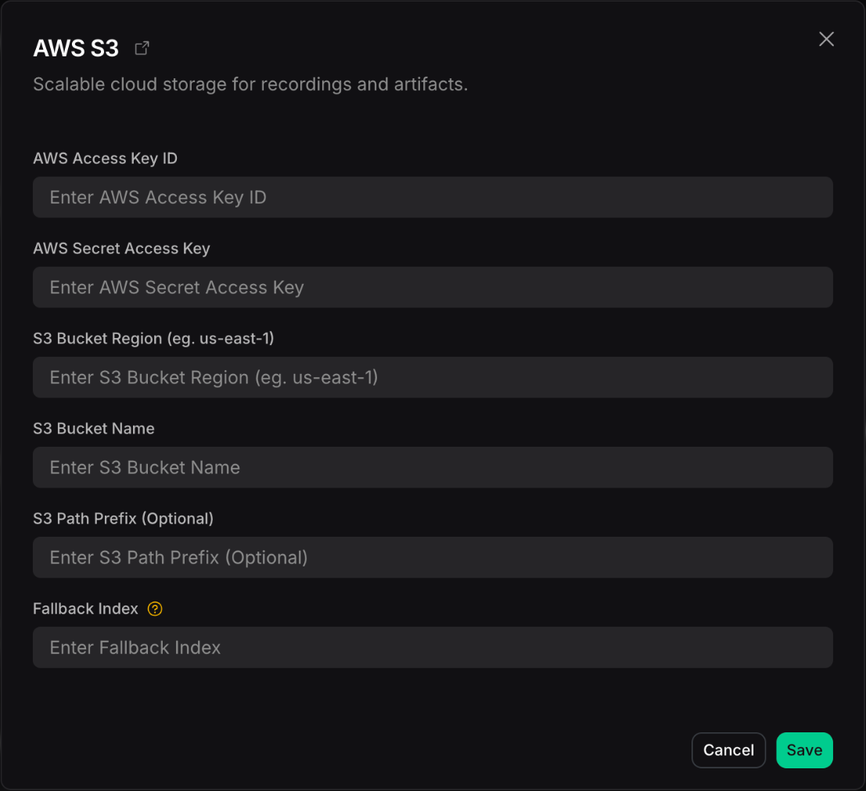

Your assistants can be configured to record chat conversations and upload
the recordings to a bucket in AWS S3 when the conversation ends.  You will
need to configure the credential and bucket settings in the **Cloud Providers**
section of the **Integrations** page in the Vapi dashboard.

Vapi can authenticate to your bucket in two ways:

- **Access keys**: an AWS Identity and Access Management (IAM) user's access key ID and secret access key. For more information, see AWS's guide to [managing IAM user access keys](https://docs.aws.amazon.com/IAM/latest/UserGuide/access-keys-admin-managed.html).
- **Role-based (AWS STS)**: Vapi uses AWS Security Token Service (STS) to assume an IAM role in your account and receives short-lived credentials. No long-lived keys are shared. For more information, see [Role-based credentials (AWS STS)](#role-based-credentials-aws-sts).

## Credential Settings

Setting                  | Description
------------------------ | -------------------------------------------------------
AWS Access Key ID        | The access key id for AWS
AWS Secret Access Key    | The secret access key for AWS
S3 Bucket Name           | The name of the bucket to upload recordings to
Bucket Path Prefix       | An optional path prefix for recordings uploaded to the bucket. Supports [LiquidJS Date format](https://liquidjs.com/filters/date.html) templating - for example, `{{ "now" \| date: "%Y/%m/%d" }}` renders as YYYY/MM/DD.

## Example

<Frame caption="Example Configuration">
  
</Frame>

## Role-based credentials (AWS STS)

With role-based credentials, you create an IAM role in your AWS account that trusts Vapi's AWS account. When Vapi uploads a recording, it calls STS `AssumeRole` on your role and uses the temporary credentials it receives.

### Prerequisites

- An S3 bucket for your recordings
- IAM permissions to create roles and policies in the account that owns the bucket
- A Vapi private API key, if you create the credential through the API

<Steps>
  <Step title="Create an IAM role">
    Create the role that Vapi will assume.

    1. Open the **IAM Console** in AWS
    2. Go to **Roles** and click **Create role**
    3. Select **Custom trust policy** as the trusted entity type
    4. Paste a trust policy from the next step

    <Tip>
    Choose a descriptive name for the role, such as `VapiS3RecordingsRole`.
    </Tip>
  </Step>

  <Step title="Attach the trust policy">
    The trust policy allows Vapi's production AWS account, `533267069243`, to assume the role.

    <Warning>
    Set the principal to Vapi's account root, `arn:aws:iam::533267069243:root`. Do not name a specific Vapi IAM user or role. Vapi may change which of its IAM identities calls `AssumeRole`, and a trust policy that names a specific identity stops working when that happens. Trusting the account root does not give every identity in Vapi's account access; it lets Vapi's account grant `sts:AssumeRole` only to the identity that needs it.
    </Warning>

    An External ID is optional. If you use one, enter the same value in the trust policy's `sts:ExternalId` condition and in the Vapi credential's `authenticationPlan.externalId`.

    For more information, see AWS's guides to [creating a role with a custom trust policy](https://docs.aws.amazon.com/IAM/latest/UserGuide/id_roles_create_for-custom.html) and [using External IDs for third-party access](https://docs.aws.amazon.com/IAM/latest/UserGuide/id_roles_common-scenarios_third-party.html).

    <Tabs>
      <Tab title="With External ID">
        Replace `YOUR_UNIQUE_EXTERNAL_ID` with a unique value before use. AWS recommends an External ID for third-party cross-account access.

        ```json title="Trust policy with External ID"
        {
          "Version": "2012-10-17",
          "Statement": [
            {
              "Effect": "Allow",
              "Principal": {
                "AWS": "arn:aws:iam::533267069243:root"
              },
              "Action": "sts:AssumeRole",
              "Condition": {
                "StringEquals": {
                  "sts:ExternalId": "YOUR_UNIQUE_EXTERNAL_ID"
                }
              }
            }
          ]
        }
        ```
      </Tab>
      <Tab title="Without External ID">
        Use this policy only if you do not require an External ID for the role. This policy does not check which Vapi customer the request is for.

        ```json title="Trust policy without External ID"
        {
          "Version": "2012-10-17",
          "Statement": [
            {
              "Effect": "Allow",
              "Principal": {
                "AWS": "arn:aws:iam::533267069243:root"
              },
              "Action": "sts:AssumeRole"
            }
          ]
        }
        ```
      </Tab>
    </Tabs>
  </Step>

  <Step title="Attach the permissions policy">
    Give the role access to your bucket. Replace `YOUR_BUCKET_NAME` with your bucket name. To limit access to a path prefix, replace `/*` with `/YOUR_PREFIX/*`.

    ```json title="Permissions policy"
    {
      "Version": "2012-10-17",
      "Statement": [
        {
          "Effect": "Allow",
          "Action": [
            "s3:PutObject",
            "s3:ListMultipartUploadParts",
            "s3:GetObject",
            "s3:DeleteObject"
          ],
          "Resource": "arn:aws:s3:::YOUR_BUCKET_NAME/*"
        }
      ]
    }
    ```

    | Action | Purpose |
    |--------|---------|
    | `s3:PutObject` | Upload recordings, including multipart uploads of large files |
    | `s3:ListMultipartUploadParts` | Complete multipart uploads |
    | `s3:GetObject` | Read back recordings that Vapi uploaded |
    | `s3:DeleteObject` | Delete recordings that Vapi uploaded. Omit it if Vapi should never delete objects. |

    If your bucket uses server-side encryption with AWS Key Management Service keys (SSE-KMS) and a customer managed key, also allow `kms:GenerateDataKey` and `kms:Decrypt` on that key.

    Before attaching the policy, you can check it with [IAM Access Analyzer policy validation](https://docs.aws.amazon.com/IAM/latest/UserGuide/access-analyzer-policy-validation.html).

    To attach the policy:

    1. In the IAM Console, go to **Policies** and click **Create policy**
    2. Select **JSON** and paste the policy
    3. Name the policy, for example `VapiS3RecordingsPolicy`
    4. Attach the policy to your IAM role
  </Step>

  <Step title="Create the Vapi credential">
    Create a credential with the role's Amazon Resource Name (ARN) and bucket details, in the dashboard or through the API.

    <Tabs>
      <Tab title="Dashboard">
        <Note>
        The dashboard form has no External ID field. If your trust policy requires an External ID, create the credential through the API.
        </Note>

        1. In the Vapi dashboard, open the [AWS integration](https://dashboard.vapi.ai/settings/integrations?selectedIntegration=aws)
        2. In **AWS STS Credentials**, enter the **Role ARN** of the IAM role you created
        3. Enter the **S3 Bucket Region** and **S3 Bucket Name**
        4. Optionally, enter a **Path Prefix** for uploaded recordings, for example `recordings/`, and a **Fallback Index**
        5. Save the credential
      </Tab>
      <Tab title="API">
        Create an `aws` credential:

        ```bash title="Create credential via API"
        curl -X POST "https://api.vapi.ai/credential" \
          -H "Authorization: Bearer YOUR_VAPI_API_KEY" \
          -H "Content-Type: application/json" \
          -d '{
            "provider": "aws",
            "authenticationPlan": {
              "type": "aws-sts",
              "roleArn": "arn:aws:iam::YOUR_AWS_ACCOUNT_ID:role/VapiS3RecordingsRole",
              "externalId": "YOUR_UNIQUE_EXTERNAL_ID"
            },
            "bucketPlan": {
              "name": "YOUR_BUCKET_NAME",
              "region": "us-east-1",
              "pathPrefix": "recordings/"
            }
          }'
        ```

        | Field | Description |
        |-------|-------------|
        | `provider` | Must be `aws` |
        | `authenticationPlan.type` | Must be `aws-sts` |
        | `authenticationPlan.roleArn` | The ARN of the IAM role you created |
        | `authenticationPlan.externalId` | Optional. Include only with the matching External ID trust policy. |
        | `bucketPlan.name` | The S3 bucket name |
        | `bucketPlan.region` | The AWS Region of the bucket, for example `us-east-1` |
        | `bucketPlan.pathPrefix` | Optional path prefix for uploaded recordings, for example `recordings/` |
        | `fallbackIndex` | Optional. The order in which this storage provider is tried during upload retries. Lower numbers are tried first. |

        If you chose the trust policy without an External ID, omit the `externalId` field.
      </Tab>
    </Tabs>
  </Step>
</Steps>

### Troubleshooting

- **`AccessDenied` on `sts:AssumeRole`**: The trust policy doesn't allow Vapi to assume the role. Check that the principal is `arn:aws:iam::533267069243:root`, not a specific Vapi IAM user or role, and that the External ID matches.
- **External ID mismatch**: The `externalId` in your Vapi credential must exactly match `sts:ExternalId` in the trust policy. If you don't use an External ID, remove the `Condition` block from the trust policy and the `externalId` field from the credential.
- **`AccessDenied` on upload**: The role's permissions policy doesn't cover the bucket or prefix, or a bucket policy or KMS key policy denies access. Check the `Resource` ARN and any path prefix restriction.
