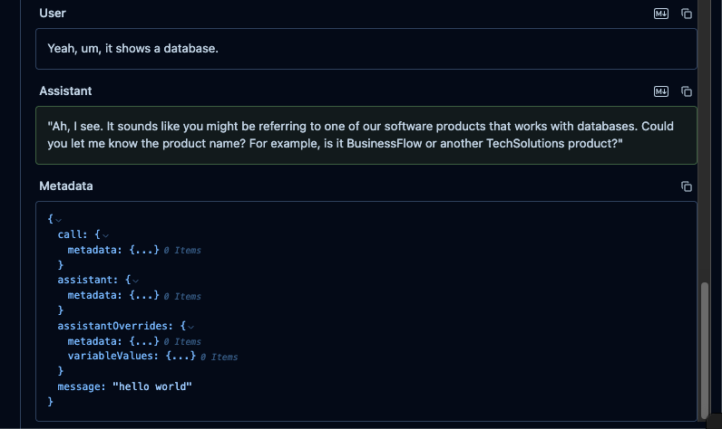

# Langfuse Integration

Vapi natively integrates with Langfuse, allowing you to send traces directly to Langfuse for enhanced telemetry monitoring. This integration enables you to gain deeper insights into your voice AI applications and improve their performance and reliability.

<Frame>
  

    <iframe
      src="https://www.youtube.com/embed/V4ybHNWvu90?si=QDCINdagfM47Exn4"
      title='An embedded YouTube video titled "Langfuse Integration with Vapi"'
      frameborder="0"
      allow="fullscreen; accelerometer; autoplay; clipboard-write; encrypted-media; gyroscope; picture-in-picture; web-share"
      allowfullscreen
      referrerpolicy="strict-origin-when-cross-origin"
    />
  

</Frame>

## What is Langfuse?

[Langfuse](https://langfuse.com/) is an open source LLM engineering platform designed to provide better **[observability](https://langfuse.com/docs/observability/overview)** and **[evaluations](https://langfuse.com/docs/evaluation/scores/overview)** into AI applications. It helps developers track, analyze, and visualize traces from AI interactions, enabling better performance tuning, debugging, and optimization of AI agents.

## Get Started

<Steps>
<Step title="Get your Langfuse Credentials">

First, you'll need your Langfuse credentials:

- **Secret Key**
- **Public Key**
- **Host URL**

You can obtain these by signing up for [Langfuse Cloud](https://cloud.langfuse.com/) or [self-hosting Langfuse](https://langfuse.com/docs/deployment/self-host).

</Step>

<Step title="Add Langfuse Credentials">

Log in to your Vapi dashboard and navigate to the [Integrations page](https://dashboard.vapi.ai/settings/integrations).

Under the **Observability Providers** section, you'll find an option for **Langfuse**. Enter your Langfuse credentials:

- **Secret Key**
- **Public Key**
- **Host URL** (US data region: `https://us.cloud.langfuse.com`, EU data region: `https://cloud.langfuse.com`)

Click **Save** to update your credentials.

<Frame caption="Vapi Provider Credentials.">
  
</Frame>

</Step>

<Step title="See Traces in Langfuse">

Once you've added your credentials, you should start seeing traces in your Langfuse dashboard for every conversation your agents have.

<Frame caption="Example trace of Vapi conversation in Langfuse.">
  
</Frame>

Example trace in Langfuse: https://cloud.langfuse.com/project/cloramnkj0002jz088vzn1ja4/traces/50163c14-9784-4cb9-b18e-23e924d0bb66

</Step>

<Step title="Evaluate and Debug your Agent">

To make the most out of this integration, you can now use Langfuse's [evaluation](https://langfuse.com/docs/scores/overview) and [debugging](https://langfuse.com/docs/analytics/overview) tools to analyze and improve the performance of your voice AI agents. 

</Step>
</Steps>

## Server Version Detection and SDK Routing

When you save a Langfuse credential, Vapi probes your server's `/api/public/health` endpoint and automatically resolves the Langfuse server version. The credential stores this resolved version, and Vapi uses it to pick the export path for your traces:

- **Langfuse Cloud and self-hosted servers on version 3.63 or later** receive traces through the Langfuse JS SDK v5 OTLP export path.
- **Self-hosted servers on versions earlier than 3.63** continue to receive traces through the legacy v3 ingestion API.

You do not need to configure anything; routing follows the resolved server version. All Langfuse Cloud regions (`us.cloud.langfuse.com`, `hipaa.cloud.langfuse.com`, `jp.cloud.langfuse.com`, and `cloud.langfuse.com`) are fully supported, and self-hosted Langfuse v3 remains supported through the upstream v3 patch window ending January 31, 2027.

If Vapi cannot reach your server when you save the credential, you can enter the server version manually. The next successful probe corrects the stored version automatically.

## Troubleshooting

**Host URL is refused when saving.** Host URLs that redirect to a different origin are rejected because trace exports do not follow redirects. For example, `https://eu.cloud.langfuse.com` redirects to `https://cloud.langfuse.com`, so use `https://cloud.langfuse.com` directly. The error message names the URL to use.

**Traces stop appearing during calls.** If tracing fails during a call, for example because your server became unreachable or was upgraded or downgraded across the v3/v5 boundary, Vapi emits a call log error linking to the [credentials page](https://dashboard.vapi.ai/keys). Re-save your Langfuse credential there so Vapi can re-resolve the server version.

## Enrich Traces
Vapi allows you to enrich Langfuse traces by integrating [Metadata](https://langfuse.com/docs/tracing-features/metadata) and [Tags](https://langfuse.com/docs/tracing-features/tags).

By default, we will add the following values to the metadata of each trace:

- `call.metadata`
- `assistant.metadata`
- `assistantOverrides.metadata`
- `assistantOverrides.variableValues`

### Usage
You can enhance your observability in Langfuse by adding metadata and tags:

**Metadata**

Use the [`assistant.observabilityPlan.metadata`](/api-reference/assistants/create#request.body.observabilityPlan.metadata) field to attach custom key-value pairs.

Examples:
- Track experiment versions ("experiment": "v2.1")
- Store user segments ("user_type": "beta_tester")
- Log environment details ("env": "production")

**Tags**

Use the [`assistant.observabilityPlan.tags`](/api-reference/assistants/create#request.body.observabilityPlan.tags) field to add searchable labels.

Examples:
- Mark important runs ("priority")
- Group related sessions ("onboarding", "A/B_test")
- Filter by feature ("voice_assistant")

Adding metadata and tags makes it easier to filter, analyze, and monitor your assistants activity in Langfuse.

### Example

