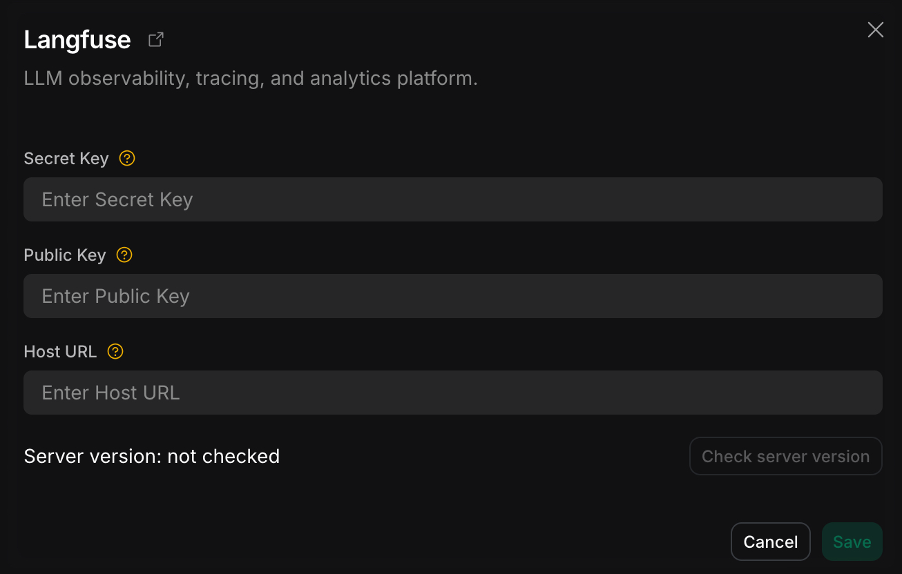
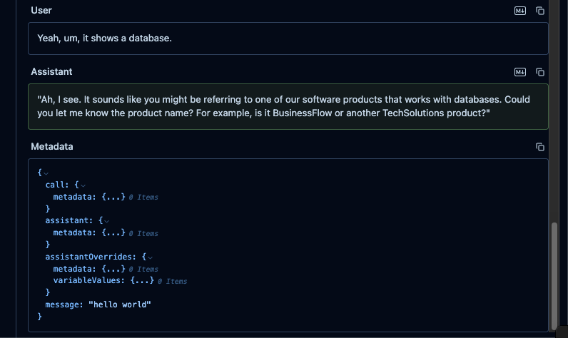

# Langfuse Integration

Vapi natively integrates with Langfuse, allowing you to send traces directly to Langfuse for enhanced telemetry monitoring. This integration enables you to gain deeper insights into your voice AI applications and improve their performance and reliability.

This page covers connecting Langfuse to Vapi. For Langfuse's own guide to working with traces once they arrive, see the [Langfuse tracing documentation](https://langfuse.com/docs/tracing).

<Frame>
  <div class="video-embed-wrapper">
    <iframe
      src="https://www.youtube.com/embed/V4ybHNWvu90?si=QDCINdagfM47Exn4"
      title='An embedded YouTube video titled "Langfuse Integration with Vapi"'
      frameborder="0"
      allow="fullscreen; accelerometer; autoplay; clipboard-write; encrypted-media; gyroscope; picture-in-picture; web-share"
      allowfullscreen
      referrerpolicy="strict-origin-when-cross-origin"
    />
  </div>
</Frame>

## What is Langfuse?

[Langfuse](https://langfuse.com/) is an open source LLM engineering platform designed to provide better **[observability](https://langfuse.com/docs/observability/overview)** and **[evaluations](https://langfuse.com/docs/evaluation/scores/overview)** into AI applications. It helps developers track, analyze, and visualize traces from AI interactions, enabling better performance tuning, debugging, and optimization of AI agents.

## Get Started

<Steps>
<Step title="Get your Langfuse Credentials">

First, you'll need your Langfuse credentials:

- **Secret Key**
- **Public Key**
- **Host URL**

You can obtain these by signing up for [Langfuse Cloud](https://cloud.langfuse.com/) or [self-hosting Langfuse](https://langfuse.com/docs/deployment/self-host).

</Step>

<Step title="Add Langfuse Credentials">

Log in to your Vapi dashboard and navigate to the [Integrations page](https://dashboard.vapi.ai/settings/integrations).

Under the **Observability Providers** section, you'll find an option for **Langfuse**. Enter your Langfuse credentials:

- **Secret Key**
- **Public Key**
- **Host URL** (US data region: `https://us.cloud.langfuse.com`, EU data region: `https://cloud.langfuse.com`)

When you finish editing the Host URL, Vapi reads your Langfuse server's version from its unauthenticated `{Host URL}/api/public/health` endpoint, and the **Server version** row fills in with what it found. You can also trigger the check yourself with **Check server version**. **Save** stays disabled until a version is resolved, so every saved credential knows which server it points at. Editing the Host URL clears the version, because a version belongs to the server it was read from.

If your `/api/public/health` endpoint is hidden behind a proxy or firewall, a **Server version** field appears so you can state the version yourself (for example `3.63.0`). The Host URL itself must still resolve to a public address over HTTP or HTTPS; Vapi probes and exports from the public internet, so a loopback, link-local, or private-network host is refused regardless of the version you enter.

Click **Save** to update your credentials.

<Frame caption="Langfuse in Vapi Integrations.">
  
</Frame>

</Step>

<Step title="See Traces in Langfuse">

Once you've added your credentials, you should start seeing traces in your Langfuse dashboard for every conversation your agents have.

<Frame caption="Example trace of Vapi conversation in Langfuse.">
  
</Frame>

Example trace in Langfuse: https://cloud.langfuse.com/project/cloramnkj0002jz088vzn1ja4/traces/50163c14-9784-4cb9-b18e-23e924d0bb66

</Step>

<Step title="Evaluate and Debug your Agent">

To make the most out of this integration, you can now use Langfuse's [evaluation](https://langfuse.com/docs/scores/overview) and [debugging](https://langfuse.com/docs/analytics/overview) tools to analyze and improve the performance of your voice AI agents.

If you are on Langfuse Cloud and already run LLM-as-a-judge evaluators, note that Langfuse retires its legacy evaluators on November 16, 2026; their [migration guide](https://langfuse.com/faq/all/llm-as-a-judge-migration) covers the upgrade, and their UI walks you through it.

</Step>
</Steps>

## Server Version Detection and SDK Routing

Vapi exports traces over two paths: the modern OpenTelemetry (OTLP) path of the Langfuse JS SDK v5, and the legacy v3 ingestion API. Which one your credential uses follows the Langfuse server version resolved when you saved it:

- **Langfuse Cloud** always uses the OTLP path. Cloud is recognized by its hostname, so this applies to credentials saved at any time, including before this feature existed. All Cloud regions are supported: `us.cloud.langfuse.com`, `hipaa.cloud.langfuse.com`, `jp.cloud.langfuse.com`, and `cloud.langfuse.com`.
- **Self-hosted on 3.63 or later** uses the OTLP path, once the credential has a detected server version.
- **Self-hosted on versions earlier than 3.63**, and **any self-hosted credential with no detected version**, continues on the legacy v3 ingestion API.

<Note>
If you self-host and saved your credential before version detection existed, it has no stored version, so your traces stay on the legacy path. That is a working path and nothing is interrupted, but upgrading your Langfuse server alone will not move you: **re-save the credential in the Vapi dashboard** so Vapi reads your server's current version. Nothing re-probes on its own, and the stored version changes only when you save again.
</Note>

Self-hosted Langfuse v3 remains supported through the upstream v3 patch window ending January 31, 2027.

<Note>
**Langfuse Cloud removes its legacy ingestion API and legacy features on November 16, 2026**, in every region. Vapi's own export is handled: Cloud credentials use the OTLP path, so your traces keep arriving. The one thing that may need your attention is in your Langfuse project rather than in Vapi: if you use Langfuse's legacy LLM-as-a-judge evaluators, migrate them before that date. See Langfuse's [LLM-as-a-judge migration guide](https://langfuse.com/faq/all/llm-as-a-judge-migration) and their [v4 upgrade guide](https://langfuse.com/faq/all/upgrade-to-langfuse-v4). Self-hosted servers are unaffected by this date and upgrade on your own schedule.
</Note>

## Trace IDs and Call Correlation

On the OTLP export path, a trace ID is an OpenTelemetry trace ID: exactly 32 hexadecimal characters. A Vapi call ID is a UUID, so it cannot be used as a trace ID directly. Vapi therefore **derives** the trace ID from the call ID, as the first 32 hex characters of its SHA-256 hash. The derivation is deterministic, so the same call always produces the same trace ID.

Every trace also carries the call ID as `metadata.callId`, which is the recommended way to correlate. Filtering and searching by call ID in the Langfuse UI is unaffected.

<Warning>
On the legacy v3 path, a trace's ID *was* the Vapi call ID verbatim. If your own code reads or writes Langfuse traces by using a call ID as the trace ID, for example scoring a trace from an end-of-call webhook, update it to either filter on `metadata.callId` or compute the derived ID.
</Warning>

Computing the derived trace ID:

<CodeBlocks>
```typescript title="TypeScript"
import { createHash } from 'crypto';

const traceId = createHash('sha256').update(callId).digest('hex').slice(0, 32);
```
```python title="Python"
import hashlib

trace_id = hashlib.sha256(call_id.encode()).hexdigest()[:32]
```
</CodeBlocks>

## Troubleshooting

**The Host URL redirects to another origin.** Host URLs that redirect elsewhere are refused, because trace exports do not follow redirects: the save would succeed and the exports would silently go nowhere. For example, `https://eu.cloud.langfuse.com` redirects to `https://cloud.langfuse.com`, so use `https://cloud.langfuse.com` directly, which is Langfuse's recommended base URL for EU-region projects and does not change where your data is stored. The error message names the URL to use instead.

**The Host URL must resolve to a public address.** Vapi probes and exports from the public internet, so a Host URL that is not `http`/`https`, or that resolves to a loopback, link-local, or private-network address, is refused. Entering a server version by hand does not bypass this.

**Vapi could not detect your server's version.** This means `{Host URL}/api/public/health` did not answer, or answered without a version, which is typical when a proxy or firewall sits in front of it. Enter your server's version yourself in the **Server version** field, as `major.minor.patch` exactly how your server's health endpoint reports it (for example `3.63.0`).

**Traces stop appearing during calls.** If tracing fails mid-call, for example because your server became unreachable or was upgraded across the 3.63 boundary, Vapi writes an error into that call's logs with a link to the [credentials page](https://dashboard.vapi.ai/keys). Re-save your Langfuse credential there so Vapi reads your server's current version; nothing re-detects it in the background.

## Enrich Traces
Vapi allows you to enrich Langfuse traces by integrating [Metadata](https://langfuse.com/docs/tracing-features/metadata) and [Tags](https://langfuse.com/docs/tracing-features/tags).

By default, we will add the following values to the metadata of each trace:

- `call.metadata`
- `assistant.metadata`
- `assistantOverrides.metadata`
- `assistantOverrides.variableValues`

### Usage
You can enhance your observability in Langfuse by adding metadata and tags:

**Metadata**

Use the [`assistant.observabilityPlan.metadata`](/api-reference/assistants/create#request.body.observabilityPlan.metadata) field to attach custom key-value pairs.

Examples:
- Track experiment versions ("experiment": "v2.1")
- Store user segments ("user_type": "beta_tester")
- Log environment details ("env": "production")

<Note>
On the Langfuse JS SDK v5 export path, each top-level metadata key becomes one trace attribute, and nested values are serialized as JSON strings. A trace keeps at most 512 metadata keys; any keys beyond the first 512 are dropped. Vapi's own identifiers, such as the call ID, are added separately and are always kept, even if your metadata uses the same key name. Keep metadata to a small set of filterable values and store large payloads elsewhere, referencing them by ID.
</Note>

**Tags**

Use the [`assistant.observabilityPlan.tags`](/api-reference/assistants/create#request.body.observabilityPlan.tags) field to add searchable labels.

Examples:
- Mark important runs ("priority")
- Group related sessions ("onboarding", "A/B_test")
- Filter by feature ("voice_assistant")

Adding metadata and tags makes it easier to filter, analyze, and monitor your assistants activity in Langfuse.

### Example

