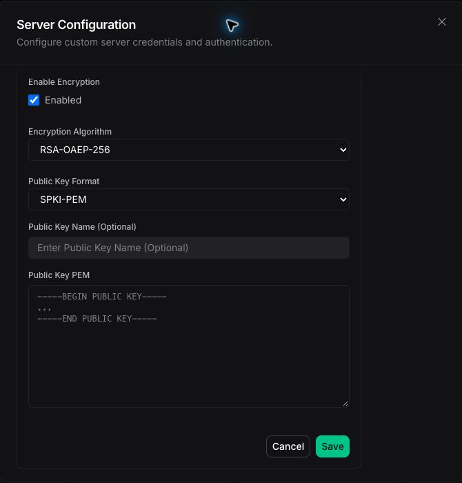
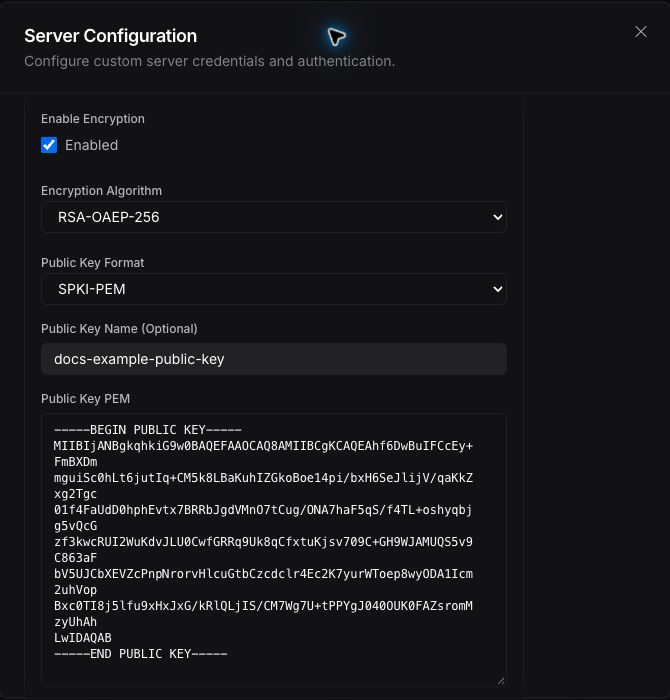
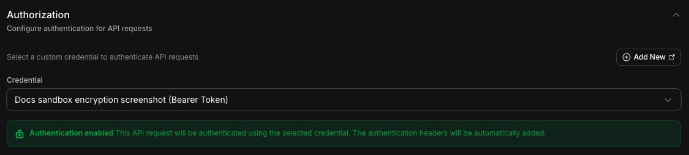
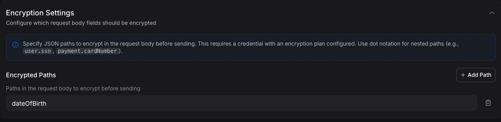

## Overview

Tool argument encryption protects sensitive data like Social Security Numbers, Credit Card Numbers, and other PII by encrypting specific fields before they're sent to your server.

**In this guide, you'll learn to:**
- Create and configure a custom credential with encryption enabled
- Generate RSA public/private key pairs
- Configure tools to encrypt specific argument fields
- Decrypt encrypted data on your server

## Prerequisites

- A Vapi account with access to the Dashboard
- OpenSSL or a similar tool for generating RSA keys
- A server endpoint that can receive and decrypt encrypted data

<Steps>
  <Step title="Create a custom credential with encryption">
    1. Open the [Vapi Dashboard](https://dashboard.vapi.ai), select **Integrations**, then select **Server Configuration**.
    2. Select **Add Custom Credential**. Choose the **Authentication Type** your server uses and complete its required fields.
    3. Select **Enable Encryption** and confirm **RSA-OAEP-256** for **Encryption Algorithm** and **SPKI-PEM** for **Public Key Format**.

    <Frame caption="Enable encryption in custom credential settings">
      
    </Frame>
  </Step>

  <Step title="Generate RSA key pair">
    Use OpenSSL to generate a public/private key pair in PEM format.

    Run this command in your terminal to generate both keys:

```bash
# Generate a 2048-bit RSA private key
openssl genrsa -out private-key.pem 2048

# Extract the public key in SPKI format
openssl rsa -in private-key.pem -pubout -out public-key.pem
```

    This creates two files:
    - `private-key.pem` - Keep this secure on your server for decryption
    - `public-key.pem` - Copy this to Vapi for encryption

    <Warning>
    Never share or commit your private key. Store it securely in your server's environment variables.
    </Warning>
  </Step>

  <Step title="Add public key to credential">
    Copy and paste your public key into the Dashboard.

    1. Open `public-key.pem` and copy the entire contents.
    2. Paste the public key into **Public Key PEM**.
    3. Select **Save**.

    <Frame caption="Example public key in the credential form">
      
    </Frame>

    Your credential is now ready to use with encrypted tool arguments.
  </Step>

  <Step title="Select a tool to configure">
    1. Select **Tools** in the Dashboard.
    2. Open an existing **Function tool** or **API Request tool**, or create a new tool.
  </Step>

  <Step title="Configure credential and encryption settings">
    Link your encryption credential and specify which fields to encrypt.

    1. Expand **Authorization** and select the credential you created from **Credential**.
    2. Expand **Encryption Settings** and select **Add Path** for each request body field you want encrypted.
    3. Enter each field's exact path under **Encrypted Paths**.

    **Example JSON paths:**
    - `ssn` - Encrypts the `ssn` field
    - `payment.cardNumber` - Encrypts nested fields

    <Note>
    JSON paths are relative to the tool's argument structure. Only specified fields will be encrypted.
    </Note>

    <Frame caption="Select the custom credential in Authorization">
      
    </Frame>

    <Frame caption="Configure encryption settings">
      
    </Frame>
  </Step>

  <Step title="Publish and test the configuration">
    Publish your tool configuration and verify encryption works with a test call.

    1. Select **Publish** to apply the tool draft.
    2. Make a test call using an assistant with this tool.
    3. Trigger the tool during the call.
    4. Check your server logs to confirm encrypted data arrives.

    When your server receives the webhook, encrypted fields will appear as base64-encoded strings:

```json
{
    "fullName": "John Doe",
    "dateOfBirth": "ZCT0EvFkJRHShBd06Ldu7ImHgl7YCuX8l8IF/7xuQSydafVWRR2eCGqTeXK7HyMaXyDc3hHyaTwTKyd0kJH0TCgQEJwviTLSlt7IzH4BIVXIadYcmCUbcSN77R6HoYtGE/De8hEYZ0t+bfuKnDY1IyiQXViI1oE+A2hiscrl4x9Or+n3CUSvxXQ3fJREsCHVN4Y4jbLtQOh0bhlsKLol7GEXBGnOG+oBlXvIzEgyco/peusg7Vzeq42F9odQyZZop9u8+ynwz3DOCm9JBZdOuf7iCKKos0NU+VeWanUHvJ2aJfGPck7qleFWDFsCb+F6QcIcn3fkiKTqoYa44vQ+NA=="
}
```
  </Step>

  <Step title="Decrypt data on your server">
    Use your private key to decrypt the base64-encoded encrypted values.

    Here's how to decrypt the data in your server code:

<CodeBlocks>
```typescript title="TypeScript (Node.js)"
import crypto from 'crypto';
import fs from 'fs';

function decryptToolArgument(encryptedBase64: string): string {
  // Load your private key
  const privateKey = fs.readFileSync('private-key.pem', 'utf8');
  
  // Decode from base64
  const encryptedBuffer = Buffer.from(encryptedBase64, 'base64');
  
  // Decrypt using RSA-OAEP with SHA-256
  const decrypted = crypto.privateDecrypt(
    {
      key: privateKey,
      padding: crypto.constants.RSA_PKCS1_OAEP_PADDING,
      oaepHash: 'sha256',
    },
    encryptedBuffer
  );
  
  return decrypted.toString('utf8');
}

// Example usage
const encryptedDateOfBirth = "ZW5jcnlwdGVkX2RhdGFfaGVyZQ==...";
const decryptedDateOfBirth = decryptToolArgument(encryptedDateOfBirth);
console.log(decryptedDateOfBirth); // Original value
```
```python title="Python"
from cryptography.hazmat.primitives import serialization, hashes
from cryptography.hazmat.primitives.asymmetric import padding
from cryptography.hazmat.backends import default_backend
import base64

def decrypt_tool_argument(encrypted_base64: str) -> str:
    # Load your private key
    with open('private-key.pem', 'rb') as key_file:
        private_key = serialization.load_pem_private_key(
            key_file.read(),
            password=None,
            backend=default_backend()
        )
    
    # Decode from base64
    encrypted_data = base64.b64decode(encrypted_base64)
    
    # Decrypt using RSA-OAEP with SHA-256
    decrypted = private_key.decrypt(
        encrypted_data,
        padding.OAEP(
            mgf=padding.MGF1(algorithm=hashes.SHA256()),
            algorithm=hashes.SHA256(),
            label=None
        )
    )
    
    return decrypted.decode('utf-8')

# Example usage
encrypted_date_of_birth = "ZW5jcnlwdGVkX2RhdGFfaGVyZQ==..."
decrypted_date_of_birth = decrypt_tool_argument(encrypted_date_of_birth)
print(decrypted_date_of_birth)  # Original value
```
</CodeBlocks>

    <Tip>
    Store your private key in environment variables rather than hardcoding the file path. Use `process.env.PRIVATE_KEY` or `os.getenv("PRIVATE_KEY")`.
    </Tip>
  </Step>
</Steps>

## Security best practices

Follow these guidelines to maintain secure encryption:

- **Never commit private keys** - Use environment variables or secret management systems
- **Rotate keys periodically** - Generate new key pairs and update credentials regularly
- **Encrypt selectively** - Only encrypt fields that contain sensitive data to minimize overhead
- **Validate decrypted data** - Always validate and sanitize decrypted values before use
- **Use HTTPS** - Ensure your server endpoint uses HTTPS for transport security

## Next steps

Now that you have tool argument encryption configured:

- **[Function tools](/tools/custom-tools):** Learn more about creating Function tools
- **[API request tools](/tools/default-tools#api-request):** Configure API request tools with encrypted arguments
- **[Server URLs](/server-url):** Set up secure server endpoints for receiving encrypted data
