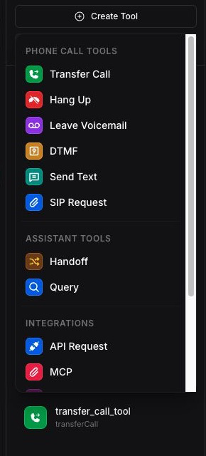
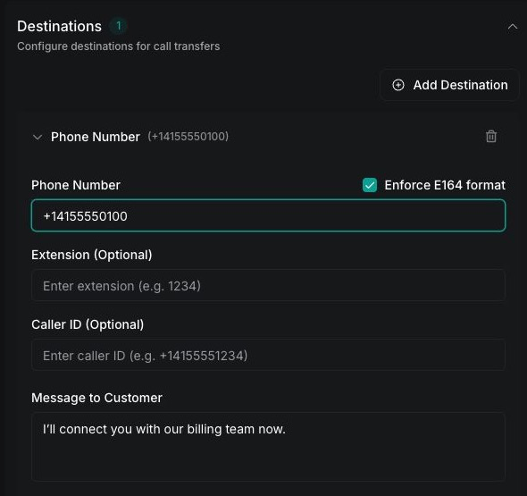
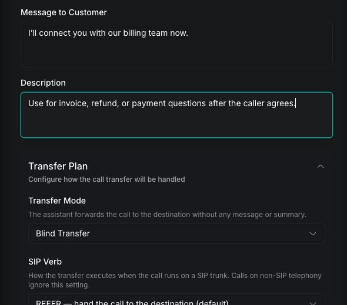
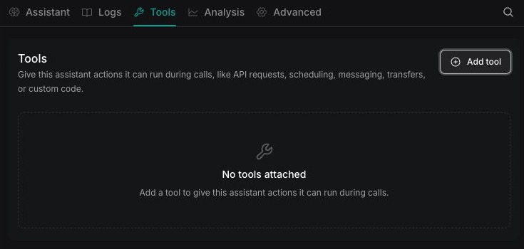

Create a transfer call tool, give it destinations and messages, and add it to an assistant. For how transfers behave, which mode to choose, and what happens when a transfer fails, see the [Transfer Call tool overview](/tools/transfer-call).

## Prerequisites

Before you create the tool, prepare:

- A Vapi assistant that handles phone calls
- A reachable destination: a phone number in E.164 format, for example `+14155550100`, or a Session Initiation Protocol (SIP) URI
- A private Vapi API key for the curl method

## Configure the transfer call tool

Create a reusable transfer call tool, define its destinations, and add it to an assistant.

<Tabs>
  <Tab title="Dashboard">
    <Steps>
      <Step title="Create the tool">
        Open **Tools** in the [Vapi Dashboard](https://dashboard.vapi.ai/tools), click **Create Tool**, and select **Transfer Call**.

        <Frame caption="Select Transfer Call from the Create Tool menu">
          
        </Frame>
      </Step>

      <Step title="Describe when to transfer">
        Under **Tool Settings**, enter a clear **Tool Name** and **Description**. Describe the conditions that should trigger a transfer so the assistant can choose the tool reliably.

        For example:

        ```text title="Description"
        Transfer the caller to a billing specialist when they ask about an
        invoice, refund, or payment. Only transfer after the caller agrees.
        ```
      </Step>

      <Step title="Add a destination">
        Under **Destinations**, click **Add Destination**, then select **Phone Number** or **SIP**. Enter the destination and a specific description of when the assistant should use it.

        For a phone number, use E.164 format, including the `+` prefix and country code. If you add multiple destinations, give each one a distinct description so the assistant can route the caller correctly.

        <Frame caption="Configure a phone-number destination">
          
        </Frame>
      </Step>

      <Step title="Configure the transfer message">
        Optionally enter a message for the assistant to say before the transfer. By default, the assistant says `Transferring the call now`. A message can be at most 1,000 characters. To choose which message plays or to transfer silently, see [Configure transfer messages](#configure-transfer-messages).
      </Step>

      <Step title="Choose the transfer mode">
        Expand **Transfer Plan** to choose how this destination receives the call. Leave **Blind transfer** selected for an immediate transfer, or see [Choose a transfer mode](/tools/transfer-call#choose-a-transfer-mode) to compare the modes. **Transfer mode** offers these options:

        - [Blind transfer](/tools/transfer-call/blind-transfer#choose-a-blind-transfer-mode)
        - [Blind transfer with summary in SIP header](/tools/transfer-call/blind-transfer#choose-a-blind-transfer-mode)
        - [Warm transfer with message](/tools/transfer-call/warm-transfer#choose-a-warm-transfer-mode)
        - [Warm transfer with summary](/tools/transfer-call/warm-transfer#choose-a-warm-transfer-mode)
        - [Warm transfer with TwiML](/tools/transfer-call/warm-transfer#configure-twiml)
        - [Warm transfer - wait for operator, then say message](/tools/transfer-call/warm-transfer#choose-a-warm-transfer-mode)
        - [Warm transfer - wait for operator, then say summary](/tools/transfer-call/warm-transfer#choose-a-warm-transfer-mode)
        - [Warm transfer - experimental](/calls/assistant-based-warm-transfer#how-assistant-based-warm-transfer-works)

        <Frame caption="Describe the route and choose its transfer mode">
          
        </Frame>
      </Step>

      <Step title="Publish the tool">
        Select **Publish** in the tool header. Review the changes, then select **Next**. Enter a **Version Name** and, optionally, a **Description**. Select **Publish** to make the tool version current.
      </Step>

      <Step title="Add the tool to an assistant">
        Open **Assistants** and select the assistant. In the assistant's **Tools** section, select **Add tool** and choose the new transfer call tool. Update the system prompt to state exactly when the assistant should transfer the call, and require the assistant to invoke the tool in the same response as its spoken acknowledgment.

        <Frame caption="Open the assistant's Tools section and select Add tool">
          
        </Frame>
      </Step>

      <Step title="Publish the assistant">
        Select **Publish** in the assistant header. Review the changes, then select **Next**. Enter a **Version Name** and, optionally, a **Description**. Select **Publish** to make the assistant version current.
      </Step>
    </Steps>
  </Tab>

  <Tab title="curl">
    <Steps>
      <Step title="Create the tool">
        Send a request to the [Create Tool endpoint](/api-reference/tools/create). Replace `YOUR_API_KEY` with a private Vapi API key and `+14155550100` with the phone number that should receive the call.

        ```bash
        curl --request POST \
          --url https://api.vapi.ai/tool \
          --header 'Authorization: Bearer YOUR_API_KEY' \
          --header 'Content-Type: application/json' \
          --data '{
            "type": "transferCall",
            "destinations": [
              {
                "type": "number",
                "number": "+14155550100",
                "description": "Transfer to billing for invoice, refund, or payment questions"
              }
            ]
          }'
        ```

        The object inside `destinations` sets the transfer target. For a phone number, set `type` to `number` and provide the destination in the `number` field using E.164 format.

        To transfer to a SIP endpoint instead, replace that destination object with:

        ```json
        {
          "type": "sip",
          "sipUri": "sip:support@example.com",
          "description": "Transfer to the support queue for technical issues"
        }
        ```

        You can add more destination objects to the array. Use each destination's `description` to tell the assistant when to select it.

        To change the default `Transferring the call now` announcement, add `message` to the destination object. See [Configure transfer messages](#configure-transfer-messages) for silent transfers and other message types.

        The response contains the reusable tool's `id`. Save it as `TOOL_ID` for the next request.
      </Step>

      <Step title="Add the tool to an assistant">
        Replace `YOUR_API_KEY`, `ASSISTANT_ID`, and `TOOL_ID`, and replace `EXISTING_TOOL_ID` with the IDs of any tools already on the assistant. Then update the assistant with the [Update Assistant endpoint](/api-reference/assistants/update).

        ```bash
        curl --request PATCH \
          --url https://api.vapi.ai/assistant/ASSISTANT_ID \
          --header 'Authorization: Bearer YOUR_API_KEY' \
          --header 'Content-Type: application/json' \
          --data '{
            "model": {
              "provider": "openai",
              "model": "gpt-4o",
              "toolIds": ["EXISTING_TOOL_ID", "TOOL_ID"]
            }
          }'
        ```

        The example uses an OpenAI model. Keep the assistant's current model configuration and include any existing tool IDs in the `toolIds` array. Updating the array replaces its current contents.
      </Step>

      <Step title="Update the assistant prompt">
        In the assistant's system prompt, define when to transfer and require the assistant to invoke the tool in the same response as its spoken acknowledgment.

        ```text
        Transfer the caller to billing only when they ask about an invoice,
        refund, or payment and agree to be transferred. When you decide to
        transfer, acknowledge the request and invoke the transfer call tool in
        the same response.
        ```
      </Step>
    </Steps>
  </Tab>
</Tabs>

## Choose a destination

Use the destination type that matches the system receiving the call.

| Destination | Use it for | Required value |
| --- | --- | --- |
| Phone number | A person, department, or public switched telephone network (PSTN) endpoint | `number` in E.164 format |
| SIP | A SIP trunk, private branch exchange (PBX), or other SIP endpoint | `sipUri` |

For a phone-number destination that uses an extension, set `extension` instead of adding the extension to `number`. The extension is dialed after the destination answers.

A destination's `description` tells the assistant when to select it. Keep each description specific to a routing intent, for example, billing, sales, or technical support.

To choose among stored destinations based on an API lookup, follow [Transfer calls using API Request and Transfer Call tools](/calls/transfer-calls-with-api-lookup). To select or construct a destination at runtime instead of storing it on the tool, follow [Dynamic call transfers](/calls/call-dynamic-transfers).

### Route to multiple destinations

A single transfer call tool can contain multiple phone-number destinations, SIP destinations, or a mix of both. When the assistant invokes the tool, it uses the conversation and each destination's `description` to select one destination; it does not call every destination in the array.

In the Dashboard, click **Add Destination** for each route. Give every destination a distinct description, then add matching routing rules to the assistant's system prompt. For example:

```text title="System prompt"
- Transfer billing questions to the billing phone number.
- Transfer purchase questions to the sales phone number.
- Transfer technical incidents to the support SIP URI.
- If the caller's intent is unclear, ask which team they need before transferring.
```

With the API, add one object for each route to `destinations`. Each object can have its own message and transfer plan. When updating a tool, include every destination that should remain because the new `destinations` array replaces the existing array.

<Note>
To move the conversation to another Vapi assistant, use the [handoff tool](/squads/handoff) instead of a phone or SIP transfer. Handoff works between standalone assistants and between assistants in a Squad, and can carry conversation context into the destination assistant.
</Note>

## Configure transfer messages

The assistant says one message before the transfer starts. By default, the message is `Transferring the call now`, spoken in the transcriber's language. Setting the tool's `messages` array to any value, including an array with only a `request-failed` message, removes this default.

Vapi picks the message in this order:

| Message | When it plays |
| --- | --- |
| The destination's `message` | The model selected that destination. The destination the model passes must match the stored `number` or `sipUri` exactly. |
| The tool's `request-start` message | No destination message applies. |
| The tool's `request-complete` message | No destination message or `request-start` message is set. |

Only one of these plays, and it finishes before the transfer starts.

### Transfer without a message

To transfer silently, set the destination's `message` to an empty string. This works for destinations stored on the tool. A destination your server returns in response to a [`transfer-destination-request`](/server-url/events#transfer-destination-request) can't use an empty message to make the transfer silent.

### Respond when your server refuses a transfer

When your server responds to `transfer-destination-request` with an error instead of a destination, the transfer doesn't happen. Add a `request-failed` message to the tool's `messages` so the caller hears what happened:

```json
{
  "messages": [
    {
      "type": "request-failed",
      "role": "system",
      "content": "The transfer was refused. Tell the caller the reason from the tool result and offer to help."
    }
  ]
}
```

With `role` set to `system`, the model reads the content as an instruction and explains the refusal in its own words. With the default `assistant` role, the assistant speaks the content as written. If the tool has no `request-failed` message, the caller hears the default `Transferring the call now` and then no transfer happens.

The `request-response-delayed` message type doesn't apply to transfers. To avoid silence while your server chooses a destination, respond quickly or store the destinations on the tool.

## Verify the transfer

Place a test call and ask for the destination described in the tool. Confirm that the call log contains a `transferCall` tool invocation and that the destination rings or answers.

The `assistant-forwarded-call` ended reason confirms that Vapi initiated or delegated the transfer. It does not confirm that the downstream telephony provider completed it, so check the provider's call logs when the destination does not receive the call.

If the transfer doesn't behave as expected, see [Troubleshoot call transfers](/phone-calling/in-call-control/transfer-calls/debug-forwarding-drops).

## API reference

The [Create Tool API reference](/api-reference/tools/create) documents the transfer call fields, destination types, transfer plans, messages, and rejection settings. The [Update Assistant API reference](/api-reference/assistants/update) documents how to assign reusable tools with `model.toolIds`.

## Related guides

<CardGroup cols={2}>
  <Card title="Transfer Call tool overview" icon="fa-light fa-phone" href="/tools/transfer-call">
    Transfer modes, what the destination receives, and outcomes.
  </Card>
  <Card title="Troubleshoot call transfers" icon="fa-light fa-phone-slash" href="/phone-calling/in-call-control/transfer-calls/debug-forwarding-drops">
    Diagnose transfers that don't start, connect, or recover.
  </Card>
</CardGroup>
